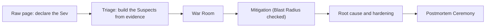
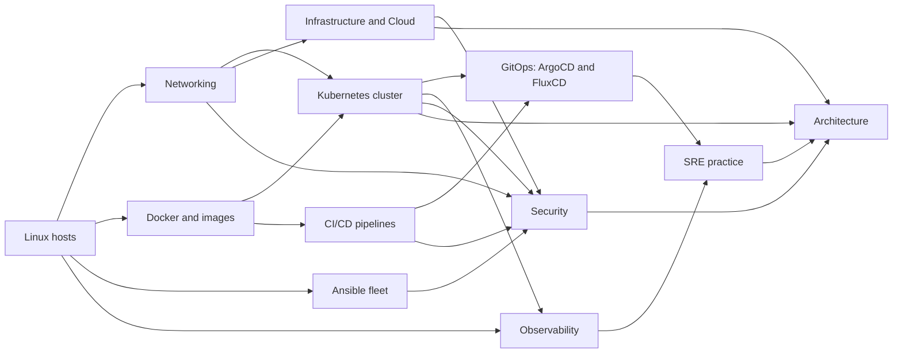
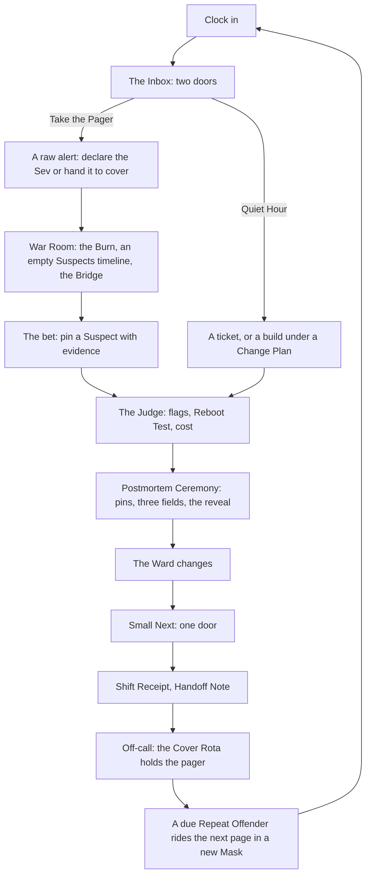

# enjoydevops.io: Gamification Strategy White Paper

| | |
|---|---|
| **Version** | 1.0 |
| **Date** | 2026-09-27 |
| **Status** | Idea stage |

> You do not take a course here. You take a job. The pager is the loop, the Burn is the clock, the Error Budget is the health bar, the rating is the number that climbs, the postmortem is the reward screen, and the Title on your profile was earned in a room with the Board dark and no hints.

## Table of Contents

1. [Executive Summary](#1-executive-summary)
2. [Why DevOps Learning Is Broken, and Why We Ban Video](#2-why-devops-learning-is-broken-and-why-we-ban-video)
3. [Vision and Design Pillars](#3-vision-and-design-pillars)
4. [The Player](#4-the-player)
5. [The World and the Story](#5-the-world-and-the-story)
6. [Content Formats](#6-content-formats)
7. [Incident Simulation: The Crown Jewel](#7-incident-simulation-the-crown-jewel)
8. [Progression and Mastery](#8-progression-and-mastery)
9. [The Loops](#9-the-loops)
10. [Reward Economy](#10-reward-economy)
11. [Social, Competitive and Community](#11-social-competitive-and-community)
12. [Look, Feel and Sound](#12-look-feel-and-sound)
13. [Habit Design and Ethics](#13-habit-design-and-ethics)
14. [Monetisation](#14-monetisation)
15. [Positioning Against Existing Platforms](#15-positioning-against-existing-platforms)
16. [Risks and How the Design Defuses Them](#16-risks-and-how-the-design-defuses-them)
17. [A Day, a Month and a Year in the Life](#17-a-day-a-month-and-a-year-in-the-life)
18. [Appendix](#18-appendix)

---

## 1. Executive Summary

Every platform that teaches DevOps sells a library you read through or a scoreboard you climb; both have an ending. enjoydevops.io sells the third thing: a job you cannot put down. You are hired at **Cormorant**, a fictional company with a real production estate, and you own a slice of it, **the Ward**, which pages you on your terms. A page is a raw alert you triage yourself, judged by a machine that restarts whatever you touched before it believes you fixed the cause, and the same failures come back in new Masks until they cannot hurt you. Your profile is a Title earned with the Board dark, a rating that climbs, and incidents a recruiter can replay.

**The design pillars**

- **The job is the game.** No menu, only an Inbox; no lesson, only a ticket that describes a symptom.
- **Nothing in the environment is faked.** Packets, state, alerts and the Judge are real; no page is pre-triaged.
- **The pager is the peak, not the whole.** Most nights are a ticket and a build; incidents are capped at three a week.
- **Failure is worth more than success.** A Scar is cut only from a named gap between your reasoning and the truth.
- **The same bug comes back in a new Mask.** Repeat Offenders are spaced repetition inside a fiction every operator believes.
- **Consent before compulsion.** Every clock-in asks whether you take the pager; phone pages are opt-in and capped.
- **Sell proof, size, identity, memory and the employer. Never the click.** Money changes what you own, never what the Judge says.

**How it makes money:** learning is free forever; we charge for proof (Panels from Senior up, the Dress Rehearsal), size (a bigger Ward through On-Call), identity (the Shift Pass), memory (the Archive) and the employer (Team and Game Day plans, Trial Shifts). Proof carries the business first, the Team plan is the durable business, and Trial Shifts come last.

**What we refuse to do:** no video, no points for presence, no paid retries or streak repairs, no pages outside the window, no rank for money, no sale at any moment of failure, no character who sells, no manager who sees a command log.

### The words you need

**The Ward** is the production you own; **a Shift** is one sitting; **the Rota** is the hours the app may reach you. **The Dispatcher** decides what pages you and **the Pager** delivers it. **The Judge** grades a fix by changing the system and seeing whether it survives. **A Scar** is a named gap between your reasoning and the truth; **a Mask** is the new face of an old failure, a **Repeat Offender** that failure coming back. **A Title** is earned in a **Panel**, an exam with **the Board** (the live topology) switched off: **Blind Mode**. **The Error Budget** is the Ward's health bar; **the Burn** is the clock inside one incident. **On-Call** is the one subscription: a bigger Ward, never a better grade.

---

## 2. Why DevOps Learning Is Broken, and Why We Ban Video

### The learner's pain

You finish the course, and three weeks later a Deployment is stuck in `CrashLoopBackOff` on a Friday, and nothing in forty hours of lessons prepared you, because the lessons were about how systems work and the job is about what to do when they stop. Learners churn for four reasons: **the ending** (a certificate is an exit door), **tutorial hell** (false confidence, then shame), **nothing at stake**, and **nobody waiting**.

### The hiring manager's pain

Managers do not screen for `kubectl` syntax. They ask what you look at first when three things are wrong, what changed, whether you have ever planned a risky upgrade, and whether you can write a status update without speculating. No artifact lets a candidate show that.

### What the incumbents get wrong

One cause, every platform: each gamified the wrapper and left the work untouched. The certification funnel (KodeKloud) ends at the exam; video-first libraries are watched more than finished; the root flag (HackTheBox) has no equivalent in operations, where the win is "it stayed up while I changed it"; iximiuz labs is closest and has no tomorrow. One signal matters more: Killer Shell shows a market for difficulty that is brutal and honest.

### Why we ban video

Watching is presence, and presence is the thing we refuse to score. The job is done with a terminal, a ticket, a git log and a runbook that is slightly wrong; a video would be the one artifact in the world that could not be true.

### The wedge

Nobody is pulled to 03:00: a real incident is mostly waiting and briefly terror. What is addictive is what comes after: the war story, the competence, the page that stops firing because you fixed the thing. The product compresses the misery and keeps the mastery and the story.

---

## 3. Vision and Design Pillars

**The game in five sentences.** You are hired at a company with a broken production estate and given a slice of it to keep alive. When you clock in you take the pager or you build; a page is a raw alert, and you find the cause with real tools from an empty Board. A machine grades whether traffic flows, whether you named the cause and whether it can happen again, then shows you the truth next to your version. The same failures come back wearing new Masks until they cannot hurt you, and your map and rating show what you can be trusted with tonight. Titles are earned in an exam with the Board dark; learning is free, and we sell proof, a bigger estate and the employer.

**The job is the game.** People are addicted to a place they belong to and a mess that is theirs to fix; the unit of content is a ticket that describes a symptom.

**Nothing in the environment is faked.** Every particle on the Board is a sampled real packet, the alert that pages you is the rule's real output with no severity attached, the cloud is a real provider's console, and the Judge reboots before it believes you.

**The pager is the peak, not the whole.** A product that is only a pager is a stress simulator, and stressed people leave; most Shifts are tickets and builds.

**Failure is worth more than success.** The overlay finds where your model diverged from the truth; name that gap and you hold a Scar.

**The same bug comes back in a new Mask.** Each return of a family wears a different Mask on a Surface you have not seen, so recall must transfer.

**Consent before compulsion.** This audience carries a real pager and will post the first dark pattern publicly, so the pager is taken at clock-in or handed to cover, and phone pages are an opt-in with a cap.

**Sell proof, size, identity, memory and the employer. Never the click.** The moment a player can buy the click, the Title means nothing and the business is over.

### The constitution

| Gamification failure | Rule enjoydevops.io adopts |
|---|---|
| Points for presence | **The Judge rule:** no rating, Mark, flag or Title rises without a verified change in system state; a Shift is covered only when the Judge verified one. |
| Badge spam | Awards are rare, nameable, and earned by handling danger, never by avoiding it. |
| Fake difficulty (timers, trick wording, rationed probes) | Difficulty comes only from the environment, shown as Sev (impact) and Conditions (hostility). Probes are unlimited. |
| Rewards that inflate; hints that lie | Titles are earned in a Panel with a public pass rate; the rating has an opponent and no multiplier, as in chess; specialists answer only structured questions drawn from real state. |
| Selling at the moment of failure | Nothing is sold at any moment of failure (the Trust Contract in Section 14 lists them), and no character ever sells. |
| **Named exceptions** | The Panel has a sitting window, because an exam has an end. Warm-up has a stopwatch, because nothing in it counts. The Burn is impact times duration, slowed by any mitigation that cuts impact, never a stopwatch. |

---

## 4. The Player

Four people open the app; Section 5 describes the first forty-five minutes they share.

**The Switcher.** A sysadmin moving into platform work, never paged. Wants proof a hiring manager will believe; fears being called a beginner in front of a recruiter. **The promise:** you fix something real in your first hour; your first live page arrives inside forty-eight hours; you lose your first real incident in week two and hold the most useful Scar of your month; a dated Title from Junior up sits on a public URL and you choose when to show it.

**The First-Rotation Junior.** Six months in, newly added to the on-call rota. **The promise:** you rehearse your first bad night inside hours you chose, Burn frozen the first time and live the second; you declare the Sev yourself; the Blast Radius preview fires before every high-blast verb until you switch it off at Engineer.

**The Deep-and-Narrow Senior.** Eight years in, carries a real pager, will mock anything that reads as a toy. **The promise:** the Placement Panel is one incident, twenty-five minutes, Board dark, pinned at minute zero, and with Field Promotion it puts you at Engineer on day one; Ticket Mode is your default; and your first week grants a free Dress Rehearsal, so the paid Senior Panel is sat knowing your gaps.

**The Lead.** Runs a team of six. Fears buying surveillance or a job board for their own team. **The promise:** a free aggregate Coverage Map over any Crew that consents, then a private Named Outage from the retired Boss pool, nothing to author; and a Trust Contract that says you will never see a command log.

---

## 5. The World and the Story

### Cormorant

You are hired as a junior platform engineer at **Cormorant**, a mid-sized marketplace with a payments arm: a Kubernetes cluster for the marketplace, a smaller one the payments team runs, forty unmanaged Linux boxes in **the Annex** that nobody will admit to owning, two teams that adopted ArgoCD and FluxCD respectively and have not spoken since, and an ex-employee named Marek who built most of it and documented none of it. Cormorant keeps its own timezone, six hours ahead of yours, so its worst moments land at 03:00 while your window is at 21:00.

Where Cormorant cannot plausibly need a technology at depth, **Rotations** carry it, free, as contract work in the Inbox: **Kite**, a two-person startup whose whole estate is one Docker host and a Compose file, the Rotation every new hire meets first; **Meridian Trust**, a bank on FluxCD where a Kustomization is blocked by a Role the bank will not widen; **Halvard Freight**, Ansible at scale, where a play is idempotent on ninety hosts and not the ninety-first; and **Vantage**, the vendor and the cloud seen from inside. Vantage is a persona only; the cloud is a real provider's surface, its real CLI, IAM policy language and state files, never a fictional API. The free region lives on the provider hiring managers screen hardest; a second provider is a paid region. Every Rotation ends by changing your Ward.

### The Ward and the Ward Clock

The Ward is the services and hosts in your care. It starts as one Linux box in the Annex and grows through Quiet Hour builds (Docker, a cluster, GitOps, an Ansible pool, a pipeline, a region in Terraform or OpenTofu) on real clocks. Its **Error Budget** is its health bar, and the **Ward Clock** stops a living thing from becoming a hostage:

- Entropy runs on real clocks but produces only tickets and visuals; it never burns budget. Budget burns only during a Shift you clocked into, on services you own, from bad minutes whoever caused them. A covered Shift advances Cormorant's calendar by one day; the budget runs over thirty Cormorant days and recovers as the window slides, in no other way.
- Between windows the **Cover Rota** holds the pager: worse fixes than yours (a restart, never a cause), a note titled "What you would have seen," nothing on your profile. The Ward never burns unattended.
- **Silenced is not retired.** Mute a Ward alert without a Hardened flag and its pager slot refills with a shared-estate incident one Sev higher. Retire it (the Judge re-injected the fault and no page fired) and the slot is empty.
- **There is no reset button.** Wipe `/etc` or run `terraform destroy` on the wrong workspace and you restore from what you took. With no snapshot, the rebuild is the incident: a Backups and Recovery page, budget hit one Sev up. The build "run a restore drill" is what makes the Ward survivable, and the Reboot Test never touches more than a fix and its dependents.

### The career arc

Junior, Engineer, Senior, Staff, Principal; each Title changes the Inbox, not the scenery, and everyone starts at Junior unless the Placement Panel moves them up. A Junior carries the pager from day one, and pages arrive raw from the first: name, expression, value, runbook link, no severity, because declaring the Sev is your job. An Engineer authors the Ward's alert rules (**You Wrote the Alert**), so your own noisy rule pages you at 03:00.

### The first forty-five minutes

Minute zero: fourteen unread messages, one pinned by the product: "Been on a rota before? Sit the Placement Panel (one incident, 25 minutes, Board dark) and skip the induction." Everyone else sees it again only from the profile or at the end of week one. Priya: "Welcome. Also, checkout-legacy on annex-07 is restarting again, can you look?" Under it: "If checkout-legacy restarts more than three times, run marek-fix.sh. DO NOT ask why." Minute two: `journalctl -u checkout-legacy` answers the ticket. Minute ten: a Spot the Drift ticket puts `marek-fix.sh` in root's crontab beside the unit file it keeps restarting, and beside both a cron that pulls a git repo onto the box every minute. Minute twenty: the first Sev-4, in Staging, Burn frozen, Tom offering one prompt at a time ("What does a `MemoryMax=64M` drop-in do to a service that needs 200?"); the fix is one line, and because the cron pulls from git, the fix lands in git or the cron reverts it. Minute thirty-five: the Judge re-runs the cron, reboots the box, and you answer three fields. Minute forty-five: a Shift Receipt, and a Road toward Kubernetes lit by the build ticket "put checkout-legacy in a container."

### The cast and the antagonists

**Priya Raman**, your manager, asks one question about everything: "What's the blast radius?" **Dov Halloran**, the CTO, announces migrations before telling engineering. **Tomasz "Tom" Reyes**, senior SRE, keeps the Notebook and is the one you Call for Backup; when he moves on you inherit his pager, and Priya's thread negotiating the on-call load down first stays pinned, because the product will not glamorise burnout. **Wendell Achebe**, the DBA. **mo**, who restarts things on a ninety-second fuse. **pm-dana**, who wants a status update on a cadence. Nobody in the cast ever offers you a purchase. The antagonists are never a hacker in a hoodie: **drift**; **Ms. Fenwick**, the PCI assessor whose visit is **The Audit**: she asks who has root, then "show me the segmentation between checkout and everything else"; **quietbird**, a miner in a pod nobody deployed; and above all **your own past decisions**.

### Lore only through artifacts

Nothing is narrated. Everything you know about Cormorant you learned by reading things not written for you: tickets, chat threads, postmortems, runbooks outdated on purpose, `git blame`, a `.bash_history` someone forgot to clear. One source is always true: **Tom's Notebook**, one concept per page with a runnable snippet. `git blame` as a storytelling device is `git blame` as a skill.

**The Marek Files** is a persistent deduction board of the undocumented architecture, one per region; every artifact you read and every `ss -tlnp` you run fills in a piece. Completing a region's board writes the true runbook into your Dotfiles and opens the Hardened phase of that region's boss; a player who never fills it opens that phase the slow way, by reaching Done at 03:00 on every node in the region. **Wandering** is going anywhere your RBAC allows between tickets, and a find changes state on the map, the Ward or the Ledger.

### Seasons as chapters

Every season's main arc is free while current, and each asks one question whose answer is a Ledger consequence. **The Inheritance**, the evergreen first chapter: why does `marek-fix.sh` exist, and what breaks when you delete it before fixing what it hides? **The Schism**: who ran `kubectl edit` on payments, and why does Marek's bucket credential still work? The free arc leaves a few named grey boxes on the Marek Files that only the season's side-chapter fills; the Shift Pass buys that closure, and nothing on it touches the earned surface.

### The Ledger: choices with consequences

Choices with no correct answer, and every consequence is a state change, never only a message. Push back on Dov's Friday deploy with an estimate: the deploy moves to Monday and the Friday page you would have had does not exist. `chmod 777` at 03:00 and sleep: the `777` becomes an open audit finding and The Quiet Guest's entry point until you close it. Page Wendell at 02:14 on a false alarm: his arrival costs more for the rest of the season.

### Ticket Mode

**Ticket Mode** strips the story and leaves the work: same Ward, Judge, Skill Map and pager, artifacts reduced to the ticket, the alert, the logs and the Notebook. It is the default for anyone the Placement Panel lands at Engineer and an opt-in for everyone else. It costs something, and the product says so: no Wandering and no Marek Files, so every security incident is met cold and every region boss's Hardened phase is opened the slow way. It is the worse product for the people who want it, and it is theirs.

---

## 6. Content Formats

What the brief calls labs are three things here: **Tickets** (small), **Quiet Hour builds** (a chain of tickets) and **Incidents** (paged).

### The spine and the rest

Nine things are the game: **Staging**, **Tickets**, **Quiet Hour**, **Incidents** with the **Judge**, the **Postmortem Ceremony**, the **Daily Page**, **Repeat Offenders**, the **Weekly Boss**, and the **Rota** over the **Ward**. Everything else is reached from them.

| Format | What it is for | Where the player meets it |
|---|---|---|
| **Staging** | The lesson: the War Room with the Burn frozen and Tom's commands revealed one at a time | The spine |
| **Tickets** | Three-to-ten-minute work across the whole stack, in six formats | The spine |
| **Quiet Hour builds** | Change work under a Change Plan, checked by system state | The spine |
| **The Daily Page** | One cause a day at two Sevs; **Warm-up** is its unrated triage drill | The spine |
| **Incidents** | A raw alert when you take the pager; the War Room; the Ceremony | The spine |
| **The Weekly Boss** | A Named Outage with phases and three flags, Friday to Sunday | The spine |
| **Night Shift** | Chained incidents where choices carry | An unlock; one a week free |
| **Season arcs; The Upgrade** | The campaign and the Quiet Hour Boss | Once a season |
| **The Blackout; Nines Leagues** | The 48-hour live cascade; the precision league | Once a season; an unlock |
| **Split-Pane, Rogue Commit, Red versus Blue** | The social layer (Section 11) | Unlocks; NPC fallback |
| **The Scenario Editor** | Community scenarios under the Mario Maker rule | The community's |

### The six ticket formats

**Spot the Drift.** Two states of one object, from Git and from the cluster, fleet or cloud; name the line that differs and fix it at the layer that owns the truth. **Chain Gang.** A request dying somewhere on a six-hop path; name the hop. **Idempotence Golf.** Make the second run a no-op, with par per tool: Ansible, every task `ok`; Docker, a full cache hit; Kustomize or Helm, an empty `kubectl diff` and an app that reads Synced. **One-Liner.** A symptom and a shell; any command whose output answers it passes, ranked only on correctness and whether a colleague would approve it in review at 03:00. **Build to Survive.** Three components under a budget against one chaos card; the Judge reports the SLO. **Approve or Block.** A pull request against the Ward's repo with its `terraform plan` or `helm diff` attached; approve, block or ask for one change, graded against what the Judge knows the change does once merged.

### Quiet Hour: the grammar of change

A Quiet Hour build is a chain of Quiet Hour tickets, each ten to twenty minutes, checked by system state as it grows, and the Ward keeps the half-built state between them. Every build ticket shows the page it retires. Above ticket size, every build opens with a **Change Plan**, three fields graded on a rubric: blast radius stated, rollback stated, verification stated. The Judge for a build is one sentence: the change holds through the Reboot Test and rolls back cleanly on demand. Once a season the Quiet Hour has its own Boss, **The Upgrade**: a cluster minor bump with a removed API somewhere in your own manifests, played over two Shifts, the Change Plan graded before a single node drains. Upgrades are a family in Kubernetes, GitOps and Cloud, and Dov's announced migration is the first one you plan.

### How you learn something you have never seen

"No lesson, only a ticket" is the pillar; Staging is the lesson. **Tom's Notebook** is the always-true artifact, and Read requires running its snippet. A **Shadow Replay** is a mentor's real incident transcript stepped through one command at a time. **Staging** is the same family twice: once with Tom's commands revealed one at a time, then cold, on a re-Masked sibling with different identifiers, different herrings and a different Surface, and only the cold run earns a Mark. One rule holds everywhere: no Mark and no rating is ever earned on a chain you have already seen at that Sev. The first page in any new region is Sev-4 with Staging offered first; a **Soft Gate** is a Road taken before its Notebook pages are Read, with the warning shown once.

### How easy and hard coexist

Difficulty comes only from the environment, tuned by **the Dispatcher**. Every family runs from one box to a region, so a Junior and a Staff both get Disk Full tonight: a full `/var/log` on one VM for the Junior; for the Staff, etcd at quota, `mvcc: database space exceeded`, the API read-only mid FluxCD sync wave, and a fix that is compaction, defrag, `etcdctl alarm disarm` and finding what filled etcd, because without the disarm the cluster stays read-only. Free players meet multi-region Sev-1s on Cormorant's shared estate as responders, not owners: you can Mitigate and Root Cause there, the action item is Cormorant's, and it feeds your rating and never your budget.

### How difficulty is signalled

Two signals, always shown, never confused. **Sev is impact**, declared by you against what the Judge measures: it sets the Burn allowance, the budget cost and the Bridge's panic level, and a Sev-1 can be a two-minute certificate. **Conditions 1 to 5** is diagnostic hostility, drawn from the Mask deck: missing observability, a hostile bridge, a second thing wrong, no `list` on events. The Staff's etcd is "Sev-2, Conditions 5"; the beginner's `/var/log` is "Sev-3, Conditions 1". New players climb Conditions one per clean solve and down one per loss.

---

## 7. Incident Simulation: The Crown Jewel

### What "production is down" feels like, minute by minute

It is 03:14 on Cormorant's clock and 21:14 on yours. You took the pager at clock-in:

> **CheckoutSLOBurnRateHigh** · `checkout_api:slo_burn_rate:1h > 14.4 and checkout_api:slo_burn_rate:5m > 14.4` · value 15.1 · two percent of the monthly budget burned in the last hour · runbook: link-404

No Sev on it. You declare Sev-2, because checkout is customer-facing and the burn is fast, and the allowance appears: fifteen budget-minutes. Checkout's Error Budget: 71 percent of its 43 minutes left. *mo: "I can restart the checkout pods. doing it in 90s unless someone says hold."* You type `/hold` and mo's fuse greys out. The Suspects timeline is empty; nobody pins anything for you. `argocd app history checkout` shows a release forty minutes ago, so you pin it, citing the sync, and the Bridge pulls the diff: a template change, nothing on the request path. A trace dies at the boundary to `inventory-svc`. You pin inventory, citing the trace; the release was a herring and the pin cost two budget-minutes. `argocd app history inventory` shows a sync 43 minutes ago; `git show` on that commit changes one line, a connection pool from 50 to 5. You ask the Specialist Line for active connections, and Wendell runs `pg_stat_activity`: five from inventory, all busy. The four hundred waiting are not in Postgres; they are inventory's own pool gauge. Patch the Deployment and ArgoCD's self-heal will put the five back in seconds. So you pause auto-sync, revert in git, and sync. The rollout takes ninety seconds, and you spend them on the status form, because pm-dana has typed "??" twice and the third time an exec joins. Burn rate falls under 1x. In the Reel afterwards a note points at `argocd app rollback`, which would have been faster and would have disabled auto-sync as a side effect, which you would then have had to remember.

Most nights are not this. Most nights are a ticket and a build.

### The anatomy of an incident

**The Page.** The alert arrives raw from Junior up: name, expression, value, runbook link. Declaring the Sev and deciding whom to wake are graded: over-declare and an exec joins the bridge; under-declare a real Sev-1 and the Burn runs at the real impact while nobody is there to help. One page in five is noise or resolves itself: "closed as noise, alert tuned" is a Judge outcome checked by re-firing the condition, "closed as noise, was real" is a Scar. Before you ack, every headline offers **Hand to Cover Rota**: free, a "What you would have seen" note, nothing on the profile. During the incident, **Hand to Secondary** freezes the Burn on a two-line Handoff Note.

**Triage: the Suspects.** The timeline starts empty. A Suspect is pinned only by citing evidence you produced: a command output, a log line, a metric query, a commit hash. Pre-pinned candidates exist only in Staging and on a Junior's Sev-4 with the Board on; red herrings live in the environment, not on a list. The wager is capped: two active pins, unpinning refunds nothing, a third pin costs a specialist's arrival time. A wrong pin costs burn, evidence quality is graded, and the Reel afterwards shows the signals you never looked at. When the causal pin is a change, the Judge also scores whether you rolled back before you understood.

**The War Room.** The **Terminal**: real shells, `kubectl` to `terraform`. The **Bridge**: NPC teammates with competence and agenda, and it acts if you do not: mo restarts the pods on a ninety-second fuse unless you send `/hold`; pm-dana's "??" comes on a cadence, and after two misses an exec joins. Bridge verbs are commands, not prose: `/hold`, `/rollback`, `/status`, `/page`. A status update is a three-field form graded at every Title: impact, current action and owner, next update time, no speculation. Past Engineer, any incident can be played as **Incident Commander**, with no terminal. High-blast verbs (`kubectl delete`, `terraform apply`, a play with `hosts: all`) ripple a **Blast Radius** preview across real dependency edges before they run: on through Junior, at Engineer on until you switch it off, off in Blind Mode and every Panel; Blast Radius is always scored afterwards from what changed.

**Two clocks, never confused.** The **Burn** is a game clock and says so: impact times duration against a Sev-sized allowance (five budget-minutes at Sev-4, twenty-five at Sev-1), never presented as SLO math, slowed only by mitigations that cut impact. The **Error Budget** is the Ward's health bar and real SLO arithmetic, run by the Ward Clock in Section 5: over thirty Cormorant days, checkout's 99.9 percent is 43 minutes. Off-budget: everything not on your Ward, including the Daily Page, the Weekly Boss, the Blackout and shared-estate incidents, which feed your rating.

**The Specialist Line.** Each specialist answers structured questions whose vocabulary is the curriculum, and each is a query you learn to run: the DBA's four are `pg_stat_replication`, `pg_stat_activity`, the last successful backup and the lock queue. Each costs burn as arrival time; from Engineer, Wendell is sometimes "on a plane, back in four hours" and you answer with your own hands. **Call for Backup** is the only hint system: Tom's Socratic prompts keyed to what you have pinned and what you have not looked at ("You have not opened events. Why?"), free through Junior.

**The Judge.** Three flags, scored independently. **Mitigated**: traffic flows; the hot-patch at 03:00 with auto-sync paused is a correct answer and never faces the Reboot Test. **Root Caused**: your pins overlap the chain the Judge built, with partial credit for the trigger without the latent condition. **Hardened**, in two grades: **Prevented** (a policy, a gate, a progressive rollout) and **Detected** (an alert plus proof: the Judge re-injects the fault and checks the page arrives). Root Caused and Hardened pass the **Reboot Test**, scoped to what the fix touched plus its dependents, off-budget. The walkthrough grades two paths: hot-patch with auto-sync paused (Mitigated; the Ledger records whether you re-enabled it) or revert in git and let sync do its job (Mitigated and Root Caused). Patch while self-heal is on and the fix lasts seconds: check, not checkmate. Cost is scored as **Blast Radius**, **Wasted Mutations** and **Diff Size**; probe efficiency is information in the Histogram, never score.

Security incidents add flags: **Preserved** (pod, token and image snapshotted before anything is deleted), **Contained**, **Scoped**, **Eradicated** (a persistence hunt: the Judge planted two backdoors beyond the obvious CronJob, token and image, a ClusterRoleBinding and a mutating webhook) and **Rotated**. When Scoped includes cluster-admin, which a chart default gave the pod, the accepted Hardened answer is node and CA rotation or a GitOps rebuild.

Any verdict can be **disputed**: the flag is provisionally granted, a Staff-titled reviewer rules, and the stake is one Comp Time, refunded when upheld. Dispute counts are private; the product's false-negative count is public, each one a Sev-2 against the product.

### The database-crash family

> 03:52. `postgres-primary: connection refused`. WAL corruption after the node lost power; the replica is up. Replica lag before the crash: **38 minutes**. *dba-wendell: "promote the replica and we lose 38 min of writes. WAL repair, 45 min, no promises. or PITR to 03:51, if WAL archiving was actually working. was it?"* The base backup is from Sunday; `archive_command` has been failing silently since Marek's bucket credentials rotated. There is no right answer, only a decision and a postmortem in which you defend it, where the overlay adds the pin you missed: a 38-minute replication lag was itself a page that should have fired, and it becomes your Silent Alert action item.

**Backups and Recovery** is its own family: The Restore That Never Ran, the etcd snapshot from the wrong member. The build "run a restore drill" is what lets the Dispatcher serve The Restore That Never Ran in Blind Mode weeks later; clearing that is Held, because a backup is a claim and a restore is proof. Around it live the stateful families, Replica Lag, Connection Exhaustion, WAL Fills the Disk, Lock Pile-up and Consumer Lag, because at a Cormorant-sized company the platform engineer is the DBA at 03:00.

### The cascading-failure family

The Weekly Bosses live here. **The Thundering Herd**: one config change restarts forty Deployments at once because someone made deploys faster, the cold starts blow the database pool, phase two begins when your fix, restarting faster, makes it worse, and phase three is The Probe That Lied, a liveness probe killing healthy pods under the load you created. **Two Masters**: ArgoCD and FluxCD reconciling the same namespace. **The Quiet Guest**: a supply-chain compromise inside the estate for weeks; you declare a Sev-1 on a green map, and the postmortem says that was right. **The Webhook That Blocked Everything**: an admission webhook down with `failurePolicy: Fail`, so you cannot apply the fix until you fix what blocks applies.

**Unsafe Change** lives in Pipelines, GitOps and SRE: a canary that lies because it gets no traffic; the build "make checkout's rollout progressive" arms the Blind Mode test that grants Held. **The Latest Tag** is accepted only when pinned by digest. **It Was the App** is where you read code you do not own to prove it: a retry storm without backoff, an N+1 after a deploy, a client-side pool change like the walkthrough's.

### Procedurally generated incidents: three layers above the chain

Causal chains are authored by hand, several per family, with three layers above them. **Surfaces** are authored presentations of one family (DNS as a host's package mirror, a CI runner's registry, CoreDNS, a pod's `ndots`); the Dispatcher picks a Surface you have not cleared before it re-rolls anything. **Masks** dress the chain: identifiers re-rolled per player, an observability condition, a social condition, herrings tagged compatible with the chain; the count of hostile cards is the Conditions number. **Composition** is the novelty engine above Sev-3: every Sev-2 and Sev-1 braids two families, trigger from one and latent condition from another, graded on both.

Realism against fun: metrics scrape in seconds and the ground truth is revealed, with one exception. A minority of chains end **Unresolved**: the Judge grades your list of unknowns and the detection you added, and the truth appears only when that detection fires later, because writing "we do not know" without speculating is a skill. The commands are real and every cause has happened to a real company.

### The postmortem as the reward ceremony

The ceremony is short by design: incident twenty minutes, ceremony five, full write-up whenever. The **Reel** appears, a scrubbable replay of the Board with your commands on it. To unlock the reveal you place the trigger pin and any contributing pins and answer three fields (What broke. Why it was possible. What I would change.).

Then the reveal: the **ground truth**, the chain the Judge built, laid over your version, lighting the herring you chased with the detail you missed. A Scar is cut from the delta between your pins and the truth and named from a short taxonomy of reasoning failures: anchored on the release, never opened events, trusted the green dashboard, mitigated before scoping, closed a real page as noise. Then the **Solution Histogram**: how long everyone else took, which Suspect they pinned first, a top solver's transcript beside yours. You are not alone in blaming the deploy.

The full blameless template is optional and deferrable, and feeds postmortem quality and peer review, a multiplier, never a gate, with upvotes counted only from outside the author's Crew. Action items are real: "add an alert on pool saturation" becomes an alert that fires in your next incident; "write the runbook" becomes the runbook the page links to next time, and a wrong runbook is a Scar.

---

## 8. Progression and Mastery

One sentence: **the Title is the floor, permanent; the Readiness Gauge is today, and rusts; the rating is the number that climbs; the Error Budget is the health bar.** Public by default: the Title with date and pass rate, pinned replays, the twelve-region radar. Private with a per-item toggle: everything else.

### Titles: one ladder

**Junior, Engineer, Senior, Staff, Principal.** Everyone starts at Junior. The **Placement Panel** (one incident, twenty-five minutes, Board dark, free) is a door pinned at minute zero for anyone who has been on a rota and offered to everyone else at the end of week one; it can land a player at Engineer and counts as evidence for the readiness signal, never for the Gauge. After that you write a **Promotion Packet** against a public rubric and sit a **Panel**: solo, Blind Mode, Dotfiles unloaded, several incidents plus a design question, clocked by the Burn. The Panel is the one ninety-minute block the product ever asks of you, once per Title plus one retake, with a public pass rate. Titles are permanent, dated and verifiable at a public URL; the profile shows the dated Title from Junior up, and you may hide it until Engineer. Panels through Engineer are free; Senior and above are paid. Staff adds a design question judged by Staff reviewers; Principal adds a scenario you authored that other players clear.

### The Readiness Gauge: the number that can rust

Four tiers named as on-call roles: **Shadow, Secondary, Primary, Commander.** The math is public and weighted toward the rating radar, then family strength, freshness, communication and postmortem quality. Ratings work as in chess: the incident's crowd rating is the opponent, and Wasted Mutations and Blast Radius adjust the result rather than multiplying it. A rating shows from your first rated solve with a wide band ("Networking 1180 ±200") that narrows over twenty solves. The Gauge carries a next-tier line ("Primary needs: one Done at 03:00 in Networking, status updates above 0.8 over ten incidents, one Held") and rusts after thirty idle days.

### The Skill Map

Cormorant's estate drawn plainly, twelve regions, **Roads** only where a real dependency exists. A beginner sees one lit region and the rest **Unmapped**; a veteran takes a **Field Promotion**, a compressed unguided test-out that grants Marks on a whole cluster of nodes.

A region boss is the Weekly Boss that retires into that region's permanent capstone. Networking covers CNI, Services and Endpoints, ingress, load balancer health checks, NetworkPolicy, MTU, conntrack and mesh mTLS as well as DNS and TLS; Docker covers PID 1 and signals, HEALTHCHECK and running as root.

| Region | Families that live here | Region boss |
|---|---|---|
| Linux hosts | Disk Full, OOM, Permission Denied, Runaway Cron, Backups and Recovery, Replica Lag, WAL Fills the Disk, Lock Pile-up | The 02:00 Box |
| Networking | DNS, Expired Certificate, The Endpoint That Wasn't, Conntrack Table Full, The Packet That Never Arrived, Policy Wall, The LB Health Check That Passed | Six Hops |
| Docker and images | Bad Rollout, Leaked Secret, The Deploy That Drops Requests, Root in the Container | The Latest Tag |
| Ansible fleet | Config Drift, Permission Denied | The Half-Applied Play |
| Kubernetes cluster | The Probe That Lied, Evicted, Stuck Volume, The Autoscaler Flap, The Operator That Stopped Reconciling, The Webhook That Blocked Everything, Upgrades | The Rolling Blackout |
| CI/CD pipelines | Poisoned Cache, Leaked Secret, Unsafe Change | Poisoned Cache |
| GitOps: ArgoCD and FluxCD | Config Drift, Two Masters, Unsafe Change, Upgrades | Two Masters |
| Infrastructure and Cloud | State Drift, The IAM Deny, Quota Exceeded, Upgrades | Somebody Clicked |
| Observability | Silent Alert, Noisy Neighbor, Silence a Page Correctly | Green Dashboard, Red Customers |
| Security | Leaked Secret, Permission Denied, The Quiet Guest | The Quiet Guest |
| Architecture | The Thundering Herd, Split Brain, Connection Exhaustion, Consumer Lag, It Was the App | Black Friday |
| SRE practice | every family at Sev-1; The Upgrade | The Night of Three Pages |

**Certification Overlays** (CKA, CKAD, CKS, LFCS, RHCSA, Terraform Associate) light the nodes a cert covers, and lighting one is where that exam's Dress Rehearsal is offered.

### The Five Marks

Five conditions, not a ladder; the public map shows the highest met. **Read**: you ran the node's Notebook snippet in Staging. **Done**: a guided task. **Done Cold**: unguided, on a chain you had not seen. **Done at 03:00**: you used this node inside a live incident with the Board on. **Held**: weeks later, an unannounced Repeat Offender tested it in Blind Mode on a Surface you had never seen, and you cleared it. **Rust** never removes a Mark; it schedules a page.

### Spaced repetition: Repeat Offenders

When a node reaches Done Cold, its family enrols in your pager rotation on expanding intervals from a day to two months. A due family is never an extra page: the Dispatcher folds the most overdue family into the next incident you were getting anyway, as its Mask or the second thing wrong. When the due family is being tested for Held, the page is served Blind and the pager says so: "Tonight is Blind."

> Six days since your last page and you were about to close the tab. Checkout is returning 502s on payment; `inventory-svc` resolves fine, but checkout's logs show it hanging on the external payment gateway's hostname, and you have met this family twice: a host that could not resolve its package mirror, a CI runner that could not find the registry. You open CoreDNS's config and there it is, a forward rule pointing at a resolver a Cormorant ticket retired last week; the ticket sat in your own Inbox. Same ghost, third Mask. Your interval on DNS jumps to two months and the node glows again.

**The veteran's game.** Past Held, the game is the Conditions deck, the Weekly Boss, Night Shift chains, The Upgrade and the Scenario Editor; a Senior's normal week is one Boss attempt, one Night Shift, one Conditions page and a Change Plan.

### Job-readiness and the recruiter view

The **Incident Resume** is one page: the Title with date and pass rate, the radar, three pinned incidents with postmortem and replay, the share cleared in Blind Mode. Every entry is stamped: Sev, Conditions, Board or Blind, attempt number, Call for Backup used, own Ward or shared estate, with a three-line legend ("Blind Mode: no topology map. Sev-2: customer-facing. Attempt 1: first sight."). "Kept a multi-region estate alive for thirty Shifts" is a different claim from "answered a page on someone else's," and the stamp lets a recruiter tell them apart. A week-two Resume is already worth showing: a Staging Sev-4, an Annex Sev-4 (Board on, attempt 1), and a shared-estate Sev-2 lost with a Scar named. The last twenty incidents and any three you pin stay replay-verifiable free, forever.

---

## 9. The Loops

The governing rule is the **Open Door Rule**: every ending screen shows the first move of the next thing, on the screen when you clock out, never in your pocket. The Weekly Boss is the one sanctioned cliffhanger: phase two is visible and locked at the phase boundary.

**The pager, stated once.** Every clock-in opens on two doors. **Take the Pager**: the Dispatcher serves a raw alert, it counts as a covered Shift, and it is capped at three incidents a week; on other nights the door is closed. **Quiet Hour**: the Cover Rota holds the pager, tickets and builds only, covered only if the Judge verifies a state change. An out-of-Rota clock-in asks for the window length first, because the Dispatcher never serves an incident longer than the time left. Phone pages exist only for players who switch on the Live Pager, inside a declared window, default three a week, never two in one window.

**The minute: the bet.** The reward is evidence and the hook is the wager: pin a Suspect with evidence you produced, the Bridge chases it, a wrong pin costs burn. Nothing during a live incident reveals chain membership: a command that touches a real object writes a timestamped line to the Reel, and only the postmortem overlay colours those lines by distance from the chain; live highlighting exists only in Staging. Blind Mode's tells are never about the chain: pm-dana's "??" stops when a rubric-passing update lands, mo's fuse greys out on `/hold`.

**The session: the Shift.** A Shift is one door you chose. **Small Next** is an offer, never a queue: exactly one door, drawn from the three the finished ticket opened: the Telegraph's next page ("cert tarnishes in 72h; the five-minute ticket that retires it is here"), a Marek Files box one read away, or the action item you wrote, already a ticket. Small Next and the Telegraph are the one-more driver; everything else in this paper is a return driver. The clock-out screen is the **Shift Receipt**, the **Handoff Note** and the **Next Shift Preview**.

**The day: the Daily Page.** One cause a day, the same chain for everyone with identifiers re-rolled, at two Sevs: a Sev-4 that always follows the beginner's lit region, and a Sev-2 on a published weekly rotation across the twelve regions, marked "unrated for you" when the region is Unmapped for you. Probes are unlimited; afterward your first eight probes are coloured by distance from the causal chain, so the **Share Grid** spoils nothing: `Daily Page #213 4/8 ⬜🟨🟩🟩 ✅ 1 fix`. **Warm-up** is the Daily's sixty-second drill: three alerts on screen, one is real, pin it; three wrong pins ends the run; it feeds no rating.

**The week: the Weekly Boss.** Friday evening a Named Outage opens; it closes Sunday night. The first attempt is Board on, unrated, and phase one only; phases two and three exist only in the rated attempt, Blind and on a re-Masked sibling, so the first run is a tutorial and never a preview of the answer. When it closes: the Solution Histogram with a top solver's transcript beside yours.

**The season.** A season adds a chapter to Cormorant, a Rotation and The Upgrade, and ends with the Blackout, cut into Shift-sized phases; the next chapter's first artifact is already in the Inbox.

---

## 10. Reward Economy

**The Error Budget is the health bar, not the score.** The Ward Clock in Section 5 sets its rules; what it does to play is this: exhaust it and new expansion tickets freeze while reliability tickets stay open, and a paid region is never frozen.

**The rating is the number that climbs.** Twelve per-region ratings, rated as in chess from the first solve, each shown with a band that narrows. Every rated incident feeds it; only Ward incidents touch the budget. The count of lit nodes is the progress bar until the bands narrow.

**Badges are rare.** Thirty covered Shifts, each with a high-blast verb executed and scored, and no Sev-1 you caused: earned by handling danger, not by avoiding it.

**Streaks with mercy.** The retention number is **Shifts Covered**, and it counts only Shifts in which the Judge verified a state change; clocking in is presence and counts for nothing. It feeds exactly one thing, the thirty-Shift Error Budget window. Mercy is on-call culture: **Pager Pass** (a note written in advance that hands the pager to the Cover Rota), **Comp Time** (a missed window forgiven, earned only by resolving a Sev-1 or by a postmortem upvoted from outside your Crew, banked to two, and the only stake the product ever asks of you).

**Scars.** A Scar is cut from the delta between the pins you placed before the reveal and the ground truth, named from the taxonomy, win or lose; a thrown incident has no pins and yields nothing. Scars unlock cards from the Conditions deck for that region; a Held Mark or the Engineer Title opens it too.

**Collectibles and cosmetics.** Runbook cards, earned only from the incident that teaches them, live in your **Dotfiles**, unloaded for Panels. Earned Marks on the profile cannot be bought; season cosmetics come only through the Shift Pass and never touch the profile's earned surface.

**The earned-versus-bought line.** Earned and never buyable: every number, Mark, Title, flag, Scar, mercy and badge. Bought: size, proof, memory, look and the employer. Inflation and badge spam are avoided because the Judge rule leaves nothing to grind, there is no soft currency, and the rating has an opponent and no multiplier.

---

## 11. Social, Competitive and Community

Solo play stands on its own. Every group mode below degrades into an NPC-filled session when nobody is online.

**Crews.** Free from the first week, two to eight people: they share a Rota and a channel and rate each other's Handoff Notes. Belonging is the retention, so it is never the paywall.

**Leaderboards and leagues.** The **Nines Leagues** are the only leaderboard. League score is the sum over the week's rated incidents of Sev weight times clean-solve score against par, ranked only for players with at least three rated attempts that week; Ward budget is never an input, so playing less never wins. Cohorts of thirty, re-seeded every season.

**Co-op with asymmetric information: Split-Pane Incidents.** Three roles, nobody sees the whole picture: **Eyes** has the observability stack and no terminal, **Hands** has the terminal and nothing else, **Voice** is the incident commander with the runbooks, the change log and a stakeholder chat.

**Adversary modes.** **Rogue Commit**: one player secretly plants a subtle fault, then sits on the call, steering; the only evidence is git history, sync logs and audit events. **Red versus Blue**: ten-minute rounds with roles swapping; Red plays cards with cost and loudness, Blue keeps the SLO above threshold.

**Live global events: the Blackout.** Once a season, every Ward is hit by the same cascade inside a 48-hour window. The 48 hours is the event's window, not a demand on yours: it is off-budget, the Cover Rota holds Wards outside your window, it is cut into Shift-sized phases with Hand to Secondary at each boundary, and covering one phase counts as having been there. Crews that restore early can volunteer as relief in strangers' incidents.

**Community-created scenarios: the Scenario Editor.** The Mario Maker rule applies: you cannot publish what you have not cleared yourself, in the role you marked hardest. Authors earn a revenue share when Team plans license their work, and authoring is a reviewer role on the profile, never an input to a Title.

**Public profile, spectating and replays.** The Incident Resume is the profile. Every incident produces a **Replay**, a synchronised timeline of commands, Board states and chat, with a spoiler-free grid on its cover.

---

## 12. Look, Feel and Sound

**Rule zero: honest juice.** Every particle is a sampled real packet and every animation is a real state change. The Board is not an illustration of the lab; it is the lab, rendered, and hover always shows the real object name. This is what makes animation teach instead of decorate.

**The Board is the game board.** Pods are cells whose pulse is the readiness probe; `CrashLoopBackOff` ignites, gutters and re-ignites with the backoff visibly lengthening; `OOMKilled` swells and bursts. Traffic is light along edges coloured by status code on a pinned layout that never reflows mid-incident. A credential outside a Secret glows faintly radioactive, and so does a Secret readable where it should not be, because base64 behind RBAC is only as safe as the RBAC. During a live incident nothing lights because it is on the chain; the Board shows state, never answers.

**The visual language per technology.** **Linux**: processes as roots, a runaway one choking the others. **Networking**: packets as pulses, DNS as the signpost every pulse visits first, policies as walls invisible until something hits them. **GitOps**: the **Blueprint**, Git's desired state as a wireframe over the live Board, drift as the two sliding out of register, sync as a tide that snaps them back. **Ansible**: a wave sweeping a host grid lighting ok, changed or failed.

**The animations that matter.** Pods dying and rescheduling; the **Blast Radius** ripple along real dependency edges at real timeout speeds; and the **Telegraph**, a one-tick-ahead projection: a certificate tarnishing thirty days out. When the last free build on a region closes, the Telegraph draws the next page the Ward cannot yet produce in grey, labelled unfunded: discovery as a state on the Board, not a padlock.

**Terminal as controller, dashboards as HUD.** The terminal is the only controller; nothing on the Board clicks into a mutation. Building a dashboard panel teaches PromQL because a bad query makes a useless gauge. Ceremonies are quiet: `SLO BREACHED` in plain type; `SERVICE RESTORED` with time-to-detect beneath it.

**Blind Mode.** The Board goes dark and the only light is what `kubectl`, `journalctl`, `ss`, `tcpdump` and PromQL produce. Every Panel, every rated Boss attempt and the Held Mark are earned here; Done at 03:00 is earned with the Board on.

**Sound.** Minimal, optional, mirrored visually: the pager pattern nothing else uses, and a handful of state-change cues.

---

## 13. Habit Design and Ethics

The hook model, applied honestly. **Trigger:** you clock in and choose a door; if you take the pager, the Dispatcher serves a real alert through the Pager, or, if you asked for it, the phone buzzes inside the hours you chose. **Action:** you declare the Sev and ack. **Variable reward:** sometimes one line fixes it, sometimes forty minutes teach you a subsystem. **Investment:** the postmortem, the action item that becomes an alert. Four honest sources bring people back tomorrow: responsibility for a living thing, pages you cannot predict, a document with your name on it, and the same bug in a new Mask. One honest source keeps them for one more thing tonight: the Telegraph and Small Next, a visible, ticking, preventable future on the screen. The Suspects wager is a near-miss mechanic and the paper says so; it is bounded per incident and never sold.

**The Rota.** The Rota caps the Pager, not the Shift. After your first win you draw a window on a weekly grid, and two channels are offered, both off by default, both under "off means off" and the same weekly cap: the **Live Pager**, and a weekly **Shift Summary** (what the Cover Rota did, which node is rusting). No channel you did not switch on ever reaches you, and that is the whole list, chosen on purpose.

**The mechanics of return.** Shifts Covered, Pager Pass and Comp Time are the retention layer; the Ward's entropy is the lure, always to a ten-minute win; the Error Budget never moves while you are away, while the Readiness Gauge and the map rust and say so. Silence is handled by the **Ladder of Return**, in three forms. Live Pager: day two, one low-severity in-window page; day fourteen, a Return to Service incident engineered to be won in five minutes; day thirty, the pager stops: "Your Ward is preserved. Your Rota is cleared. Set a window when you want it." Shift Summary: the same three moments as weekly lines. Clock-in only: nothing reaches you; the Return to Service incident is what the Dispatcher serves at your next clock-in. You come back to a win, not a funeral.

**The guardrails, and why the dark patterns would backfire.** No paid streak freezes or repairs, because a streak you can buy makes quitting a financial decision instead of an identity question. No pages outside the window, because alert fatigue is the most hated thing in the real job. No shame: the Cover Rota's note never touches the profile, and the Ledger records choices, never absences. No pay-to-rank or fake countdowns, because the first detected manipulation gets posted publicly. No character sells, because once a manager character pitches a subscription every later line reads as a funnel.

---

## 14. Monetisation

**Learning is free forever; proof, size, identity, memory and the employer are for sale.** Every paid moment fires when the player is winning, and every paid item below carries the reason a person pays for it.

### The Trust Contract

A published page holding only the guarantees that will never move:

- A purchase never raises a number: money changes what you own, never what the Judge says. A Panel fee buys the sitting, never the pass.
- Nothing is sold during an incident, at a breach screen, after a missed Shift or at a failed Panel's screen; the one re-offer is a single line at the start of your next Shift, "Rehearse before your free retake."
- No character who grades or helps you ever offers a purchase; every offer lives on the Roster page. No paid mercy, retries, hints or streak repairs. Every Mark is reachable without paying.
- What was free on the day you joined stays free for you; the free line moves only outward. A tier that can shrink is a trial; one that cannot is a home.
- Public by default: the Title with date and pass rate, pinned replays, the radar. Everything else is private with a per-item toggle. The Dress Rehearsal is drawn from the retired Panel pool, never the live one.
- A Team plan employer sees aggregate coverage and seats used, never a command log or a Replay. A recruiter sees a Replay only when you opt in per incident, and you are told each time.

A separate, dated **What Is Free Today** page holds scope and moves only outward: the whole Skill Map; the Daily Page; the Ward at base size; every retry, re-Masked; the Placement Panel and Titles through Engineer; a first-week Dress Rehearsal for anyone the Placement Panel lands at Engineer; the current arc; every Rotation; the current and last season's Weekly Bosses; one Night Shift a week; Crews; the last twenty incidents and three pinned, replay-verifiable forever.

### The conversion moments, mapped onto the journey

1. **The Silent Week.** No upsell, no padlocks, for seven days. On day eight the Roster page becomes visible on the profile.
2. **The investment moments.** Every Ward expansion is one, and its trigger is a state: when the last free build on a region closes, the Telegraph draws the next page the Ward cannot produce in grey, labelled unfunded. The fiction may announce what is coming (Dov: "We're going multi-region. Priya, your team owns it.") and it comes on the shared estate whether or not you buy; the offer itself is only ever the Roster page, which says plainly that On-Call is your subscription and never implies Cormorant is paying. The psychology is endowment.
3. **The readiness signal.** When rating and coverage predict a pass, the profile shows one line: "Your last twenty incidents match Senior-grade responders." Only then is the paid Panel offered, so it reads as a promotion rather than a pitch. For a veteran the Placement Panel counts as evidence, so the signal can fire inside the first week.
4. **Uncertainty, not confidence.** The Dress Rehearsal is a standing Inbox item from Engineer up, because the buyer's state is doubt. Lighting a Certification Overlay is a self-declared exam intent, and that exam's Dress Rehearsal is offered there.
5. **Keep the night.** At the close of a Weekly Boss you cleared, and after a Blackout phase you covered, the Shift Pass is offered.
6. **The colleague invite.** When a Lead wants the Coverage Map for a Crew, the Team plan is offered to the Lead, never to the engineers.
7. **The rolling window.** When an incident you are proud of is about to leave the free verifiable window, one line: "Your Thundering Herd Sev-1 leaves the verifiable window after your next Shift. Pin it or keep the Archive." Loss aversion over an artifact you made, offered when you are winning, never when someone is watching.

### Tiers

**On-Call** is the single consumer subscription, per person; one subscription seats up to three members of a Crew, who co-own the payer's Ward expansions. It sells scale, not access: a second region, a thirty-host fleet, a multi-pipeline conveyor, and the Sev-1 shapes that only exist at scale on an estate you own, so Hardened at multi-region scale and "own Ward, Sev-1" on the Resume happen only here. Its recurring value in one sentence: a living estate that keeps producing incidents with your name on the postmortem, and a **Dress Rehearsal** you can re-sit whenever its gap list changes, because the gap list rusts like the Gauge. The Dress Rehearsal is a timed Blind Mode sitting from the retired Panel pool or any Certification Overlay, with a verdict and a gap list and no touch on rating. On-Call also holds unlimited Night Shift (the families are free on the pager; the format is what you pay for), private Split-Pane and Rogue Commit rooms (a Crew fails together in private), the deep Boss archive, the **Archive** (every incident replay-verifiable) and the season's Shift Pass, which non-subscribers buy on its own. On cancel the paid region freezes, read-only and thawed on return: endowment on the way in, never ransom on the way out.

**The Shift Pass** is a one-off per season for non-subscribers and included in On-Call: a free track and a paid track advanced by the same play. Paid track: the season's cosmetics, the side-chapter that fills the season's named grey boxes, and the season's grid on the public profile as a "was there" stamp. Nothing on it touches the earned surface or the rating; it buys closure and belonging.

**Panels at Senior and above** are paid per attempt with a free retake inside the month, and never bundled into On-Call, because a subscriber's Title would then read as bought. The reason a learner pays: the fee plus the public pass rate is costly signalling, the thing that makes the Title legible to an employer.

**The Team plan**, per seat, sells admin, the aggregate **Coverage Map**, private events and a private league. The trigger is organisational, never a seat count: a Lead requesting a Coverage Map, or a Crew asking to put a fourth On-Call seat on one bill. The Lead's first experience is the one promised in Section 4: a free Coverage Map, then a private Named Outage, nothing to author. A **Team Rota** lets the Lead propose work-hours windows each engineer consents to; the Lead sees Shifts Covered per seat inside that window, defined as activity and never as performance, and renewal reads Coverage delta plus seats used. Seats are a shield: recruiter view and Trial Shift visibility default off, flippable only by the engineer.

**The Game Day plan** is the enterprise tier: the company's own worst postmortem arrives in a private Inbox as a Named Outage, replayable on their own architecture, because postmortem action items are never checked and a replayable private outage is the check.

**Trial Shifts and Internal Rotations.** An **Internal Rotation** is a manager-visible object inside a Team plan: mobility across the customer's own teams, consented per engineer. External **Trial Shifts** start as employer-sponsored Panels from the rotating pool with company, role and salary band attached; the player never pays; the employer pays because watching someone work a page replaces an interview and reduces a mis-hire.

**Marketplace and sponsorship.** Scenario Editor authors earn a revenue share when Team plans license their scenarios. Vendor sponsorship, only after the Trust Contract has a track record, is labelled, never on the required path, and its prize pools attach only to unrated surfaces, never to a league or a rating.

### What is never paywalled

The retry, the hint, the budget, the rank, the mercy, the postmortem, the map, the current arc, any technology in the brief, and nothing, ever, at the moment of failure.

---

## 15. Positioning Against Existing Platforms

| Platform | Where it bleeds | What enjoydevops.io does instead |
|---|---|---|
| KodeKloud | The certification exam is an exit door | Certification Overlays on a map you keep walking |
| KillerCoda | Nothing persists, nothing is at stake | Staging, and a Ward that remembers you |
| Killer Shell | One honest exam, one sitting, nothing after | The Dress Rehearsal on a map you already play |
| Pluralsight / A Cloud Guru / Coursera | Television with a quiz | No video; Team plans measure coverage, not completion |
| Codecademy | XP for presence, tutorial hell | The Judge rule; Done Cold and Done at 03:00 |
| TryHackMe | Copy the command from the paragraph above | The ticket describes a symptom; the cold run is a different sibling |
| HackTheBox | Binary root flag; onboarding cliff | Three flags; Staging with the Burn frozen |
| LeetCode | Interview theatre | The Incident Resume: three replays and how you reasoned |
| Duolingo | The streak measures the wrong thing | Shifts Covered counts verified state changes |
| iximiuz labs | A solo checklist with no tomorrow | Repeat Offenders, the Ward, a pager that waits for you |

**Positioning statement:** enjoydevops.io is the only place you can take a job instead of a course: a living estate that pages you when you take the pager, incidents judged by a machine that reboots what you touched, and a Title earned with the Board dark. The person who gets called when prod is down is who you become, not what you watched.

---

## 16. Risks and How the Design Defuses Them

| Risk | The mechanic that defuses it |
|---|---|
| Simulated on-call simulates burnout | Two doors at clock-in; the weekly cap; the Ward Clock; Hand to Secondary; the Ladder of Return |
| A causally incoherent incident destroys trust in the reveal | Authored chains; Masks tagged compatible; one bad overlay is a Sev-1 against the product |
| The Judge rejects a correct answer | Structural Root Caused; dispute with provisional grant; a confirmed false negative is a Sev-2 and the count is public |
| NPC dialogue reads as a chatbot | Structured asks only; Bridge verbs are commands; free text only where a rubric grades it |
| Any public number gets farmed | The Judge rule; Scars need pins placed before the reveal; Panels from rotating pools |
| The Board makes people worse at real tools than they believe | Terminal as the only controller; nothing lights on the chain live; Blind Mode for everything rated |
| A game-trained hire has never planned a risky change | The Change Plan rubric; rollback on demand; The Upgrade once a season |
| Too many modes, no spine | The nine named in Section 6 are the game; everything else is an unlock reached from them |

**The compounding loops, named.** The Share Grid drives Daily Page acquisition; the Crew invite drives seats; the Ward's growth drives the Telegraph, which drives expansion; public pass rates drive Panels; Certification Overlays drive the Dress Rehearsal; the Incident Resume drives Trial Shifts; the Scenario Editor keeps the Daily Page fed by players. Proof carries the business first, the Team plan sustains it, and Trial Shifts arrive once the Incident Resume has a track record.

---

## 17. A Day, a Month and a Year in the Life

### A day

It is Thursday, 12:30. Lunch, and one of the two windows you drew on the Rota. The Live Pager is on because you wanted it. Your phone: "[Ward] cert api.annex expires in 72h. Last renewal: manual." You take the Quiet Hour door, not to renew the cert but to move api.annex behind the cluster ingress so cert-manager owns it. The build ticket was already in the queue, its Change Plan three lines long. Fourteen minutes; the Judge asks for the rollback on demand, gets it, and passes the build. The Shift Receipt reads: "renewal automated, next expected page: never." Nothing buzzes again until your evening window opens.

### A month

Day one you fixed checkout-legacy's memory limit in Staging, put the fix in git because the cron would have reverted it, and drew a Rota. Day two the first live page came, a raw alert from the Annex box; you declared it a Sev-4 and took it with the Board on. The rest of week one was the Silent Week. Week two you lost your first real incident, a Sev-2 on Cormorant's shared estate: a Service with no endpoints wearing a release Mask, and you anchored on the release. The overlay showed the herring and your postmortem named it from the taxonomy, so you clocked out with a Scar, fifteen minutes off Cormorant's budget and none off yours, a rating band that moved, and an action item that is now an alert. Week three the DNS family came back as CoreDNS, folded into Wednesday's page, and you recognised the ghost. Week four the last free build on the Annex closed and the Telegraph drew a page in grey; the Roster page said On-Call holds a second region, and you paid because you had built the thing it enlarges. Your Networking rating reads 1210 with a band of 160, still narrowing.

### A year

You are an Engineer with a dated Panel at a public URL, and since spring your own alert rules page you. The restore drill you ran in the autumn is why the Dispatcher could test you on The Restore That Never Ran in Blind Mode, and you held. You planned The Upgrade over two Shifts and the removed API was in a manifest with your own name in `git blame`. Your Incident Resume has forty-one entries, one stamped "own Ward, Sev-1, Blind, attempt 1," and the Blackout phase where your Crew went in as relief for a stranger is the one you tell people about. The Senior Panel has a 38 percent pass rate, the readiness signal fired last week, and the Dress Rehearsal said two gaps, both in networking. You closed one on Tuesday. You are going to sit it.

---

## 18. Appendix

### Glossary of named mechanics

| Name | Meaning |
|---|---|
| The Ward; the Ward Clock; the Cover Rota | Your estate on real clocks; its no-hostage and no-reset rules; the NPCs who hold the pager between windows |
| The Inbox; Staging; Tickets; Quiet Hour; the Change Plan | The menu with two doors; the frozen-Burn lesson; six small formats; build chains under blast radius, rollback, verification |
| The Dispatcher; the Pager; the Rota; Shifts Covered; Pager Pass; Comp Time | What decides the page; what delivers it; when the app may reach out; the retention number and its mercies |
| Sev; Conditions; Masks; Surfaces; Repeat Offenders | Impact, declared by you; hostility 1 to 5; generated dressing; authored presentations; families that ride existing pages |
| The Burn; the Suspects; the Bridge; Call for Backup | The incident's game clock; evidence-only pins; NPCs who act; Tom's Socratic prompts |
| The Judge; the Reboot Test; Dispute | Mitigated, Root Caused, Hardened (Prevented or Detected); the security flags; contesting a verdict on a Comp Time stake |
| The Postmortem Ceremony; the Reel; the Solution Histogram; Scars | Pins and three fields unlock the ground-truth overlay; the scrubbable replay; how everyone else solved it; a named reasoning failure |
| The Open Door Rule; Small Next; the Shift Receipt; the Handoff Note | Every ending shows the next first move; one door, never a queue; the clock-out screen |
| Tom's Notebook; the Dotfiles; Wandering; the Specialist Line; Incident Commander | The one always-true artifact; runbook cards unloaded for Panels; roaming between tickets; structured asks that cost arrival time; the incident with no terminal |
| Rotations; Ticket Mode; Crews; the Placement Panel; Field Promotion; Certification Overlays | Contract work that carries a technology; the story stripped; two to eight people on one Rota; the twenty-five-minute door; the veteran's test-out; a cert's nodes lit on the map |
| The Live Pager; the Shift Summary; the Ladder of Return | The two opt-in channels; the three moments after silence |
| The Skill Map; the Five Marks; Titles; the Panel; the Readiness Gauge; the rating; the Error Budget | Twelve regions on real Roads; Read, Done, Done Cold, Done at 03:00, Held; the floor; the ninety-minute exam; today's tier; the number that climbs; the health bar |
| The Board; Blind Mode; the Telegraph; the Ledger; the Marek Files | The honest-juice topology; the Board dark; the one-tick-ahead projection; choices with state changes; the deduction board |
| The Daily Page; Warm-up; the Weekly Boss; Night Shift; The Upgrade; the Blackout; the Nines Leagues; the Scenario Editor | The formats beyond the pager |
| The Incident Resume; the Trust Contract; On-Call; the Dress Rehearsal; the Shift Pass; the Archive; the Team plan; Game Day; Trial Shifts | The hiring artifact; the money and its limits |

### Mechanic-to-psychology-to-skill matrix

| Mechanic | Psychology it uses | Skill it builds |
|---|---|---|
| The raw page | Ownership of the call | Declaring severity; deciding whom to wake; closing noise correctly |
| The bet on player-authored Suspects | Commitment and a bounded near-miss | The candidate list from raw signals; evidence over hunch |
| The Burn against a Sev allowance | Loss aversion on a bounded bar | Mitigate first, root-cause second |
| The Judge's Reboot Test | Checkmate versus check | Fix at the layer that owns the truth |
| The Change Plan | Rehearsed commitment | Blast radius, rollback and verification before a risky change |
| The Postmortem Ceremony | Closure; social proof via the Histogram | Blameless writing; naming your own reasoning failure |
| Repeat Offenders on new Surfaces | Variable-interval anticipation | Spaced recall that transfers |

### Technology coverage map

| Technology | Built | Broken |
|---|---|---|
| Linux | The Ward's first box; the restore drill | Disk Full; OOM; Runaway Cron; Replica Lag; WAL Fills the Disk; Lock Pile-up |
| Docker | Images in the Ward's registry; a HEALTHCHECK and a non-root user | The Latest Tag; The Deploy That Drops Requests; Root in the Container |
| Kubernetes | The cluster; probes, PDBs, requests and limits; The Upgrade | The Probe That Lied; Evicted; Stuck Volume; The Autoscaler Flap; The Webhook That Blocked Everything |
| Ansible | The Annex under playbooks | Config Drift; The Half-Applied Play |
| Networking | Services, ingress and NetworkPolicy for the Ward | The Endpoint That Wasn't; Conntrack Table Full; Policy Wall; The LB Health Check That Passed; DNS |
| ArgoCD and FluxCD | The Ward's GitOps choice; a progressive rollout | Two Masters; self-heal fighting a hot fix; prune deleting a namespace |
| CI/CD pipelines | The Ward's conveyor; gates as Prevented flags | Poisoned Cache; a secret in a build log; Green but not deploying |
| Infrastructure and Cloud | A region in code on a real provider; the Vantage Rotation | Somebody Clicked; The IAM Deny; Quota Exceeded; Upgrades |
| Architecture | Build to Survive; the multi-region Change Plan | The Thundering Herd; Split Brain; Connection Exhaustion; Consumer Lag; It Was the App |
| Security | Segmentation in The Audit; the rebuild with CA rotation | The Quiet Guest with planted persistence; the chart default with cluster-admin |
| SRE | The Error Budget; You Wrote the Alert; the Change Plan | Declaring the Sev; Unsafe Change; The Night of Three Pages |
| Observability | Instrumenting the Ward; the runbook you wrote | Green Dashboard, Red Customers; Silent Alert; Silence a Page Correctly |

### Open questions for the founder

1. **The home company's name.** Cormorant is a placeholder.
2. **Where the free line sits.** The Trust Contract says it can only move outward, so the first line is the permanent floor.
3. **Whether the Live Pager should ever be the default,** and whether Ticket Mode should be the default above Engineer for everyone or only for players the Placement Panel places there.
4. **Mechanism review.** Every named family, Boss and moment should pass one working practitioner before the paper is shown outside.
5. **Which real provider hosts the free region,** and how large a fraction of pages should be noise (one in five here).
